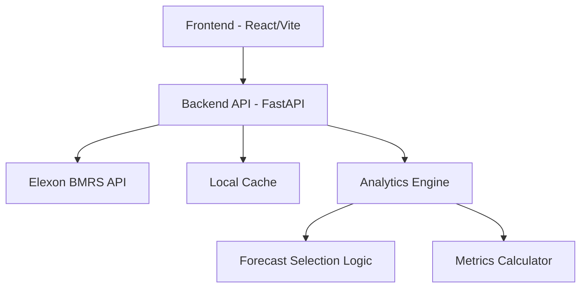

# WindLens — Day-Ahead Forecast Intelligence

A production-quality pilot application for UK electricity utility procurement teams to analyze wind generation forecasts against actuals for day-ahead market decisions.

## Product Overview

WindLens answers two essential questions:
1. **What was the latest wind generation forecast available when a procurement decision needed to be made?**
2. **How accurate was that forecast compared with actual wind generation?**

The application uses national-level wind generation data from [Elexon BMRS](https://www.elexon.co.uk/) (FUELHH for actuals, WINDFOR for forecasts) with a focus on January 2026 decision-making windows.

## Key Features

- **Decision-Time Forecast Selection**: Implements the critical logic of selecting the latest forecast published at or before the decision cutoff (10:00 Europe/London day before delivery), excluding later forecasts
- **Forecast Accuracy Analysis**: MAE, RMSE, Mean Bias Error, and coverage metrics with proper handling of missing data
- **Interactive Dashboards**: Overview, Forecast Explorer, Accuracy Analysis, and Data & Methodology views
- **Proper Timezone Handling**: Europe/London timezone awareness for UK market operations
- **Transparent Methodology**: Full documentation of data sources, selection rules, and assumptions

## Technology Stack

### Frontend
- React 18 + TypeScript
- Vite
- Tailwind CSS
- Recharts for visualizations
- React Router
- TanStack Query
- Lucide React icons

### Backend
- Python 3.12
- FastAPI
- Pydantic
- HTTPX
- Pandas & NumPy
- Pytest, Ruff

### Infrastructure
- Docker & Docker Compose
- GitHub Actions (ready to configure)

## Architecture



## Prerequisites

- Docker and Docker Compose (recommended)
- Or Node.js 20+ and Python 3.12+ for local development
- Internet access for Elexon API (or use sample data mode)

## Quick Start

### Using Docker Compose (Recommended)

```bash
# Clone and start
docker compose up --build

# Access the application
# Frontend: http://localhost
# Backend API: http://localhost:8000
# API Docs: http://localhost:8000/docs
```

### Local Development

#### Backend
```bash
cd backend
pip install -r requirements.txt
uvicorn app.main:app --reload --port 8000
```

#### Frontend
```bash
cd frontend
npm install
npm run dev
```

## Environment Variables

Copy `.env.example` to `.env` and configure:

```bash
cp .env.example .env
```

Key variables:
- `VITE_API_BASE_URL` - Frontend API endpoint
- `CORS_ORIGINS` - Allowed CORS origins
- `DECISION_CUTOFF_HOUR` - Decision cutoff hour (default: 10)
- `ELEXON_API_KEY` - Optional (not required for public datasets)

## Data Loading & Refresh

The application uses Elexon BMRS API:
- **FUELHH**: Actual generation by fuel type (filter for WIND)
- **WINDFOR**: Wind forecasts with publishTime and startTime

To refresh data, use the "Refresh Data" option in the UI or call `POST /api/data/refresh`.

**Note**: This is a pilot using January 2026 evaluation window. If live API access is unavailable, the system is designed to work with cached/normalized data.

## Forecast Selection Methodology

For each delivery interval on date D:
1. Decision cutoff = 10:00 Europe/London on D-1 (configurable)
2. Select all WINDFOR forecasts for that delivery interval published ≤ cutoff
3. Choose the latest (most recent publishTime) among eligible forecasts
4. Match to FUELHH actual for same delivery interval
5. Calculate error = forecast - actual

**Critical rules:**
- Never select forecasts published after cutoff
- Never use actuals to select forecasts
- Never fill missing data with zero
- Only compare exact delivery interval matches

## Metrics

All metrics calculated from matched forecast-actual pairs:
- **MAE** (Mean Absolute Error): average of |error|, in MW
- **RMSE** (Root Mean Square Error): sqrt of average of error², in MW
- **Mean Bias Error**: average of (forecast - actual), positive = overforecasting
- **Coverage**: (matched intervals) / (expected intervals)

MAPE is not used as primary metric because actual wind generation can be zero.

## Testing

### Backend
```bash
cd backend
pytest -v
ruff check .
```

### Frontend
```bash
cd frontend
npm run test  # if configured
npm run lint
npm run build
```

## Documentation

- [Architecture](docs/ARCHITECTURE.md) - System design and components
- [Domain & Methodology](docs/DOMAIN_AND_METHODOLOGY.md) - Detailed business logic
- [Technical Review](docs/TECHNICAL_REVIEW.md) - Code review and design decisions
- [Demo Script](docs/DEMO_SCRIPT.md) - 10-minute demo guide (5 min product + 5 min technical)

## Known Limitations

- Pilot limited to January 2026 national wind generation
- Uses 10:00 cutoff as documented assumption (verify against market rules)
- No authentication/authorization (internal demo)
- Local file cache (no distributed storage)
- Consumer demand and other generators out of scope

## AI Tool Disclosure

This project was developed with assistance from OpenCode (Big Pickle model) for code generation, architecture design, and implementation. All domain logic, critical algorithms, and design decisions have been reviewed and implemented according to the specifications.

## License

This is a pilot project for demonstration purposes.
